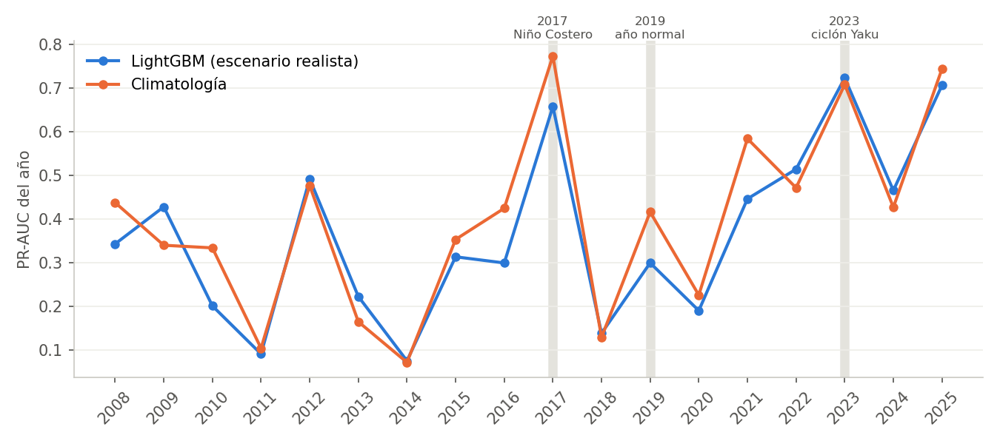
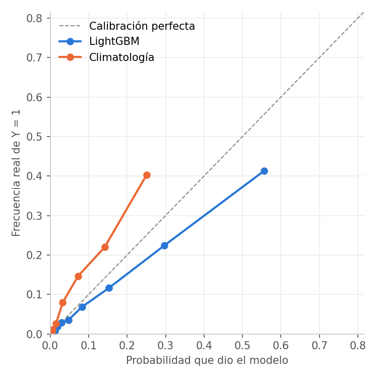

# Test de realidad del modelo de alerta

> **Actualización (6/11/2026):** las fallas encontradas aquí en el modelo por plazo ya se corrigieron. Ver
> [24_MEJORAS_TRAS_EL_TEST.md](24_MEJORAS_TRAS_EL_TEST.md).

**Pregunta:** si el modelo hubiera funcionado cada lunes desde 2008, con solo lo que se sabía ese día, ¿habría avisado
mejor que la climatología? La climatología no es un modelo: solo dice "en esta época del año este distrito suele tener
emergencias".

**Respuesta corta:**

- **El modelo de 4 semanas no supera a la climatología.** Al quitar las fugas de información, LightGBM baja de 0,393
  a 0,376 de PR-AUC. La climatología queda en 0,395.
- **Gana solo en 8 de 18 años.**
- **La diferencia no es distinguible de cero.**
- **Sí hay una señal útil a 1–2 semanas.** El modelo por plazo supera a la climatología incluso sin `emergencia_t` y
  con los datos de clima desfasados una semana.

Script: `herramientas/pruebas/evaluacion_realista.py`. Resultados: `docs/evidencia/evaluacion_realista.json` y
`data/modelo/resultados_realista/`. Etiqueta: SINPAD (INDECI) 2003–2025, 78 distritos. Se evalúa cada año de 2008 a
2025 con un modelo entrenado solo con los años anteriores; se descartan las 4 últimas semanas de entrenamiento.

```bash
python herramientas/pruebas/evaluacion_realista.py
```

## 1. Fuga de información: qué se sabía de verdad cada lunes

| Variable | Problema encontrado | Corrección en el escenario "realista" |
|---|---|---|
| Lluvia 7/30/90 días (NASA POWER) | Usa la semana t completa. El lunes aún faltan días: POWER llega con unos días de retraso. | Se usa la semana t−1. |
| Anomalías de lluvia | El "normal" se calculó con 2001–2020, es decir, con años futuros al predecir 2008–2019. | Normal calculado solo con los años de entrenamiento. |
| Caudal y razón de caudal (GloFAS) | Igual que la lluvia: semana t completa y mediana 2001–2020. | Semana t−1 y mediana solo del entrenamiento. |
| Niño 1+2 y Niño 3.4 (NOAA) | Se publican cada semana, con pocos días de retraso. | Semana t−1 (conservador). |
| Frecuencia histórica del distrito | Sin fuga: ya se calculaba solo con el entrenamiento. | — |
| `emergencia_t` (modelo por plazo) | El SINPAD publica cada seis meses. Esta variable **no existe en tiempo real**. | Se quitó. |

Hay fugas que este test **no puede corregir**:

- GloFAS y NASA POWER históricos son reanálisis, que son más precisos que los datos disponibles en tiempo real.
- La configuración del modelo (variables de la logística simple, parámetros de LightGBM) se eligió mirando la misma
  validación, incluido 2017.

Por eso estos resultados todavía son un **techo**: en la operación real, lo esperable es igual o peor. Solo la prueba
prospectiva de la sección 6 lo elimina.

## 2. Resultado global, 2008–2025 (72 930 distrito-semanas, 6 684 con Y = 1)

| Modelo | PR-AUC actual | PR-AUC realista | ROC-AUC | Brier | BSS vs. climatología | Años que gana a la climatología |
|---|---|---|---|---|---|---|
| LightGBM | 0,393 | **0,376** | 0,863 | 0,070 | +0,009 | 8 de 18 |
| Logística simple (modelo del tablero) | 0,369 | **0,355** | 0,871 | 0,141 | −1,01 | 5 de 18 |
| **Climatología** | 0,395 | **0,395** | 0,866 | 0,070 | 0 | — |
| Persistencia (¿hubo emergencia en t?) * | 0,225 | 0,225 | 0,626 | 0,079 | −0,12 | — |
| Siempre en febrero–abril | 0,228 | 0,228 | 0,772 | — | — | — |

\* La persistencia también es optimista: usa el SINPAD, que no está disponible en tiempo real.



Cómo leer la tabla:

- **PR-AUC:** 1 es perfecto. Si se ordenara a ciegas, daría la tasa de Y = 1, que es 0,092.
- **BSS (Brier skill score):** mayor que 0 significa que las probabilidades son mejores que las de la climatología.
- **La logística simple tiene BSS muy negativo porque está mal calibrada.** Se entrena con pesos que exageran la
  clase rara, así que sus probabilidades son demasiado altas. Sirve para ordenar los distritos por riesgo, pero no
  para leerla como "x % de probabilidad".

## 3. Años reservados (cada uno predicho solo con los años anteriores)

| Año | Positivos | PR-AUC LightGBM | PR-AUC logística | PR-AUC climatología | BSS LightGBM |
|---|---|---|---|---|---|
| 2017 – Niño Costero | 874 | 0,658 | 0,639 | **0,774** | +0,26 |
| 2019 – año normal | 268 | 0,299 | 0,302 | **0,416** | −0,28 |
| 2023 – ciclón Yaku | 986 | **0,723** | 0,653 | 0,708 | +0,31 |

**En 2017 y 2023 el modelo da mejores probabilidades que la climatología** (BSS +0,26 y +0,31). Detecta que esos años
son más riesgosos de lo normal. **Pero no ordena mejor los distritos**: en 2017 la climatología ordena mejor y en 2023
empatan. **En un año normal (2019) es claramente peor.**

### Avisos por evento (umbral: el 5 % de mayor riesgo del entrenamiento)

Un *episodio* empieza en una semana con emergencia en el SINPAD sin emergencias en las 2 semanas anteriores. Cuenta
como *avisado* si hubo alerta en alguna de las 4 semanas anteriores.

| Año | Modelo | Episodios avisados | Semanas en alerta | Alertas acertadas | Falsas alarmas |
|---|---|---|---|---|---|
| 2017 | LightGBM | 67 de 187 (36 %) | 8,4 % | 73 % | 92 |
| 2017 | Climatología | 45 de 187 (24 %) | 5,0 % | 83 % | 35 |
| 2019 | LightGBM | 31 de 65 (48 %) | 6,6 % | 36 % | 171 |
| 2019 | Climatología | 29 de 65 (45 %) | 5,0 % | 50 % | 103 |
| 2023 | LightGBM | 58 de 181 (32 %) | 7,6 % | 86 % | 43 |
| 2023 | Climatología | 45 de 181 (25 %) | 5,2 % | 86 % | 30 |

LightGBM avisa más episodios, pero también pasa más semanas en alerta. Con tantas alertas como el modelo, la
climatología avisaría una cantidad parecida.

## 4. Métricas complementarias, escenario realista

### Por evento, todos los años (1 441 episodios)

| Modelo | Episodios avisados | Semanas en alerta | Alertas acertadas | Falsas alarmas por distrito y temporada |
|---|---|---|---|---|
| LightGBM | 37,1 % | 6,2 % | 44 % | 1,8 |
| Logística simple | 28,7 % | 5,5 % | 42 % | 1,7 |
| Climatología | 33,1 % | 5,3 % | 46 % | 1,5 |
| Siempre febrero–abril | 82,0 % | 24,6 % | 28 % | 9,3 |

Las columnas significan:

- **Episodios avisados:** porcentaje de los 1 441 episodios con alerta en alguna de sus 4 semanas previas.
- **Semanas en alerta:** porcentaje de todas las distrito-semanas que estuvieron en alerta.
- **Alertas acertadas:** de las semanas en alerta, en cuántas hubo emergencia en las 4 semanas siguientes.

Los episodios avisados lo fueron, en mediana, con **4 semanas de anticipación**.

### Calibración



- **LightGBM sobreestima** el riesgo: cuando dice 56 %, ocurre un 41 %. Se debe a `scale_pos_weight = 3`.
- **La climatología lo subestima**, porque mezcla la tasa del distrito con la tasa regional.

Ambos ordenan bien. Ninguno debe leerse como probabilidad exacta sin recalibrarlo.

### Por plazo (la misma predicción comparada con la semana t+h)

| Plazo | Tasa | LightGBM | Climatología |
|---|---|---|---|
| h = 1 | 3,1 % | **0,167** | 0,159 |
| h = 2 | 3,1 % | 0,161 | **0,172** |
| h = 3 | 3,1 % | 0,148 | **0,174** |
| h = 4 | 3,1 % | 0,144 | **0,168** |

Las cifras son PR-AUC: la tasa es lo que daría ordenar a ciegas.

### Por departamento y tipo de año (PR-AUC)

| Grupo | LightGBM | Climatología |
|---|---|---|
| Tumbes | 0,449 | **0,475** |
| Piura | 0,349 | **0,366** |
| Años Niño Costero (2017, 2023) | 0,688 | **0,734** |
| Otros años | 0,327 | **0,350** |

La climatología gana en todos los grupos.

### Modelo por plazo (`src/prediccion_semanal.py`): ¿sobrevive sin `emergencia_t`?

| Plazo | Con `emergencia_t` | Sin `emergencia_t` | Sin `emergencia_t` y clima desfasado 1 semana | Climatología |
|---|---|---|---|---|
| h = 1 | 0,227 | 0,219 | **0,198** | 0,161 |
| h = 2 | 0,207 | 0,198 | **0,175** | 0,161 |
| h = 3 | 0,191 | 0,175 | 0,161 | 0,161 |
| h = 4 | 0,176 | 0,160 | 0,163 | 0,161 |

Las cifras son PR-AUC de la logística con variables del aviso. **Este es el único resultado positivo que resiste el
test.** Aun en condiciones realistas, el modelo por plazo supera a la climatología:

- en **un 23 % a 1 semana** (0,198 frente a 0,161);
- en **un 9 % a 2 semanas**.

A 3–4 semanas empata. Es decir, la información de lluvia, ríos y El Niño ayuda **a corto plazo**. A un mes vista, la
época del año lo explica casi todo.

Nota: los umbrales p95/p99 de lluvia y caudal de este modelo siguen calculados con 2001–2020. Además, une el SINPAD
por clave sin separar los dos Salitral. Las dos cosas quedan pendientes.

## 5. ¿La diferencia es real? (bootstrap)

| Remuestreo | Modelo | Diferencia de PR-AUC vs. climatología | IC 95 % | Probabilidad de que supere a la climatología |
|---|---|---|---|---|
| Bloques distrito × año (1 404 bloques, 1 000 réplicas) | LightGBM | −0,018 | [−0,037; −0,001] | 2 % |
| Bloques distrito × año | Logística simple | −0,039 | [−0,058; −0,020] | 0 % |
| **Años completos (18 bloques, 2 000 réplicas)** | LightGBM | −0,017 | [−0,071; +0,035] | 28 % |
| **Años completos** | Logística simple | −0,039 | [−0,088; +0,009] | 6 % |

El remuestreo por años completos es el más honesto. En un mismo año, todos los distritos se mojan juntos: un año
no aporta 78 datos independientes. Con ese remuestreo, **la diferencia de LightGBM con la climatología no es
distinguible de cero**, y la logística simple está, con 94 % de probabilidad, por debajo.

## Veredicto

1. **El modelo de alerta a 4 semanas (el del tablero) no supera a la climatología en condiciones de tiempo real.**
   Ordena los distritos por riesgo tan bien como la climatología, no mejor.
2. **En años Niño (2017, 2023) da mejores probabilidades que la climatología**, porque reconoce que el año es
   anómalo. Pero no ordena mejor los distritos, y en años normales es peor.
3. **El modelo por plazo sí aporta a 1–2 semanas**, incluso sin `emergencia_t` y con datos desfasados. Es el camino
   con más futuro: un aviso de corto plazo basado en lluvia y caudal recientes.
4. **Lo que más probablemente mejoraría el modelo a 3–4 semanas es lluvia pronosticada**, por ejemplo de SENAMHI o
   ECMWF. Con lluvia observada, el modelo no puede ver más allá de 1–2 semanas.

## Limitaciones

- La etiqueta es "el SINPAD registró una emergencia", no "hubo inundación". Hay sub-registro, sobre todo en distritos
  pequeños y antes de 2010.
- La configuración del modelo se eligió viendo esta misma validación, y los datos de clima históricos son reanálisis.
  Las cifras son un techo.
- Solo hay 18 años de prueba y 2 años Niño Costero. Cualquier conclusión sobre años Niño tiene mucha incertidumbre.
- El umbral de alerta (el 5 % de mayor riesgo) es una convención. Otro umbral cambia la proporción entre avisos y
  falsas alarmas, pero no el ordenamiento (PR-AUC).

## 6. Siguiente paso: prueba prospectiva 2027

La única prueba sin ninguna fuga es la prospectiva:

1. Congelar el modelo antes de enero de 2027.
2. Guardar cada lunes las predicciones de los 78 distritos, con fecha y hash del modelo.
3. Compararlas en mayo de 2027 con el SINPAD.

Aún no se implementa.
